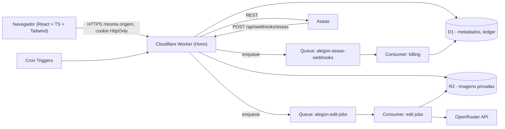
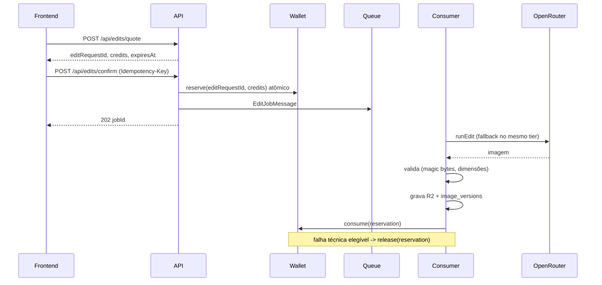

# ALEGON AI Photo Studio — Arquitetura e Contratos (CANÔNICO)

> Dono: Agente Principal (Tech Lead). Este documento é a fonte da verdade para todos os subagentes.
> Mudanças em contratos: registrar em `docs/CHANGE_REQUESTS.md` e aguardar o Tech Lead.

## 1. Visão geral

- **Um único Worker** serve a API (`/api/*`) e o SPA (Workers Static Assets, `apps/web/dist`). Mesma origem ⇒ cookies `HttpOnly; Secure; SameSite=Lax` e CSRF simples.
- **Autenticação própria** (equivalente técnico ao Supabase Auth, decisão do Tech Lead): e-mail+senha (PBKDF2-SHA256 ≥ 100k iterações via WebCrypto), sessões opacas com hash em D1, confirmação de e-mail, recuperação de senha, gestão de sessões, TOTP obrigatório para admin. Sem login social. Motivo: evita dependência externa adicional, mantém dados no mesmo perímetro LGPD e funciona 100% local com `wrangler dev`.
- **E-mail**: adaptador Resend (`RESEND_API_KEY`); sem chave ⇒ grava em `email_outbox` com `dev_logged` e loga o link (somente `ENVIRONMENT=development`).
- **Imagens**: R2 privado. Chaves: `u/{userId}/i/{imageId}/v/{versionId}.{ext}` e `.../thumb.webp`. Acesso somente via `GET /api/files/:token` (HMAC, TTL ≤ 5 min, vinculado ao usuário da sessão).
- **Conversão de formato no download** (PNG/JPG/WebP): feita no navegador via `<canvas>` a partir do arquivo autorizado (WebP somente se `canvas.toBlob('image/webp')` for suportado). Miniaturas de upload: geradas no navegador e enviadas junto; miniaturas de resultados de IA: geradas no frontend ao exibir pela primeira vez **ou** via binding Cloudflare Images se configurado (DevOps avalia).
- **Edições**: assíncronas via Queue; o frontend faz polling de `GET /api/edits/jobs/:id` (2 s → backoff até 10 s).

## 2. Fluxo de edição (obrigatório)

## 3. Contrato de API REST

Convenções:
- Base `/api`. JSON UTF-8. Erros: `{ "error": { "code", "message", "details?" } }`. Paginação: `{ items, nextCursor }` com `?cursor=&limit=` (limit ≤ 50).
- Requisições que alteram estado exigem header `X-Requested-With: alegon` (CSRF) — o cliente HTTP do frontend sempre envia.
- `Idempotency-Key` (UUID) obrigatório em: `POST /edits/confirm`, `POST /billing/checkout`, `POST /billing/subscriptions`.
- Datas ISO-8601 UTC. Dinheiro em centavos (`priceCents`). Créditos inteiros.
- Códigos de erro principais: `UNAUTHENTICATED`(401), `FORBIDDEN`(403), `MFA_REQUIRED`(403), `EMAIL_NOT_VERIFIED`(403), `NOT_FOUND`(404), `VALIDATION_ERROR`(422), `RATE_LIMITED`(429), `INSUFFICIENT_CREDITS`(402), `QUOTE_EXPIRED`(409), `CONFLICT`(409), `UPLOAD_INVALID`(415/413), `DAILY_LIMIT_REACHED`(429).

### 3.1 Auth — Backend
| Método | Rota | Corpo / Resposta |
|---|---|---|
| POST | `/auth/register` | `{email, password, fullName, acceptTerms: true, acceptPrivacy: true}` → 201 `{user}` (envia e-mail de confirmação) |
| POST | `/auth/login` | `{email, password}` → `{user, mfaRequired}` (se admin com MFA: sessão criada com `mfa_verified=0`) |
| POST | `/auth/mfa/verify` | `{code}` → `{user}` |
| POST | `/auth/logout` | → 204 |
| GET | `/auth/me` | → `{user: {id,email,fullName,emailVerified,roles,mfaEnabled}, session: {mfaVerified}}` |
| POST | `/auth/verify-email` | `{token}` → 204 |
| POST | `/auth/resend-verification` | → 202 |
| POST | `/auth/forgot-password` | `{email}` → 202 (sempre, sem enumeração) |
| POST | `/auth/reset-password` | `{token, password}` → 204 (revoga todas as sessões) |
| POST | `/auth/change-password` | `{currentPassword, newPassword}` → 204 (revoga outras sessões) |
| GET | `/auth/sessions` | → `{items:[{id,current,userAgent,createdAt,lastSeenAt}]}` |
| DELETE | `/auth/sessions/:id` | → 204 |
| POST | `/auth/sessions/revoke-others` | → 204 |
| POST | `/auth/mfa/setup` | → `{otpauthUrl, secret}` |
| POST | `/auth/mfa/enable` | `{code}` → `{recoveryCodes: string[]}` |
| POST | `/auth/mfa/disable` | `{code, password}` → 204 (admin não pode desativar) |

Senha: mínimo 10 caracteres, bloquear as 1000 mais comuns. Bloqueio progressivo após 5 falhas.

### 3.2 Conta / LGPD — Backend
| GET | `/account/profile` | `{fullName, phone, marketingOptIn, theme}` |
| PATCH | `/account/profile` | parcial |
| GET | `/account/export` | JSON com todos os dados pessoais do titular (sem binários; inclui lista de imagens com URLs assinadas) |
| POST | `/account/delete` | `{password, confirm: "EXCLUIR"}` → 202 `{scheduledFor}` (apaga imagens imediatamente; conta anonimizada; registros financeiros retidos pelo prazo legal) |
| GET | `/account/consents` | versões aceitas de termos/privacidade |

### 3.3 Projetos e imagens — Backend
| GET/POST | `/projects` | `{name}` |
| PATCH/DELETE | `/projects/:id` | |
| POST | `/images` | multipart: `file` (≤ 15 MB, JPG/PNG/WebP, ≤ 40 MP), `thumb` (WebP ≤ 200 KB, opcional), `projectId?` → 201 `{image, version}` |
| GET | `/images` | `?projectId&cursor&limit&sort=recent|expiring` → `{items:[ImageSummary], nextCursor}` |
| GET | `/images/:id` | → `{image, versions:[Version], jobs:[JobSummary]}` |
| PATCH | `/images/:id` | `{title?, projectId?}` |
| DELETE | `/images/:id` | exclusão antecipada (todas as versões + miniaturas no R2) → 204 |
| DELETE | `/images/:id/versions/:versionId` | não permitido para a original se houver outras versões? → permitido; original nunca é sobrescrita |
| POST | `/images/:id/versions/:versionId/url` | `{variant: "full"|"thumb", download?: boolean}` → `{url, expiresAt}` |
| GET | `/files/:token` | stream do R2 com `Cache-Control: private, max-age=60`, `Content-Disposition` quando download |

`ImageSummary = {id, title, projectId, createdAt, expiresAt, daysLeft, versionCount, currentVersionId, thumbUrl}`
`Version = {id, versionNumber, kind, parentVersionId, mime, width, height, sizeBytes, promptSummary, createdAt, expiresAt}`

### 3.4 Edições — Backend (usa AI + Wallet)
| GET | `/edits/tools` | → `{tools: AiToolDescriptor[], tiers: [{tier, label, credits, available}]}` |
| POST | `/edits/quote` | `{imageId, versionId, prompt, tool, tier}` → `{editRequestId, credits, tier, modelLabel, expiresAt, balance: WalletBalance}` |
| POST | `/edits/confirm` | `{editRequestId}` + `Idempotency-Key` → 202 `{jobId}` |
| GET | `/edits/jobs/:id` | → `{id, status, resultVersionId, errorCode, errorMessage, creditsCharged, createdAt, finishedAt}` |
| GET | `/edits/jobs` | `?imageId&cursor` |
| POST | `/edits/jobs/:id/cancel` | somente `queued` → libera reserva |

Limites (em `system_settings`, editáveis pelo admin): `limits.edits_per_user_per_day` (padrão 50), `limits.concurrent_jobs_per_user` (2), `limits.uploads_per_user_per_day` (100), `limits.global_daily_ai_budget_usd` (padrão 20), `limits.max_prompt_chars` (2000).

### 3.5 Carteira e cobrança — Asaas/Billing
| GET | `/wallet` | → `WalletBalance` |
| GET | `/wallet/transactions` | paginado `{id,type,bucket,amount,note,createdAt}` |
| GET | `/billing/catalog` | público → `{products:[{code,kind,name,description,credits,priceCents,creditValidityDays}], plans:[{code,name,description,monthlyCredits,priceCents}]}` |
| POST | `/billing/checkout` | `{productCode, billingType: "PIX"|"CREDIT_CARD", cpfCnpj?, name?}` + `Idempotency-Key` → `{paymentId, status, valueCents, invoiceUrl, pix?: {encodedImage, payload, expirationDate}}` |
| GET | `/billing/payments` | paginado |
| GET | `/billing/payments/:id` | `{id,status,creditsGranted,...}` (pode sincronizar com Asaas se pendente) |
| POST | `/billing/subscriptions` | `{planCode, billingType, cpfCnpj?}` + `Idempotency-Key` → `{subscriptionId, status, firstPayment: {...mesmo formato do checkout}}` |
| GET | `/billing/subscription` | assinatura atual ou `null` |
| POST | `/billing/subscription/cancel` | `{atPeriodEnd: boolean}` |
| POST | `/webhooks/asaas` | header `asaas-access-token`; persiste evento (UNIQUE id) → 200 imediato; processamento via Queue |

Cartão: **sempre pelo `invoiceUrl` hospedado do Asaas** (nenhum dado de cartão trafega pelo nosso servidor — fora do escopo PCI).

### 3.6 Notificações — Backend
| GET | `/notifications` | paginado |
| POST | `/notifications/:id/read` | |
| POST | `/notifications/read-all` | |

### 3.7 Admin (role `admin` + sessão `mfa_verified`) 
Backend (`routes/admin.ts`): `GET /admin/metrics?from&to`, `GET /admin/users?q&cursor`, `GET /admin/users/:id` (sem imagens), `POST /admin/users/:id/block|unblock`, `POST /admin/users/:id/credits {amount, bucket, note}`, `GET|PUT /admin/settings`, `GET /admin/audit-logs`, `GET /admin/storage`, `GET|POST /admin/notifications/broadcast`.
Billing (`routes/admin-billing.ts`): `GET|PUT /admin/products`, `GET|PUT /admin/plans`, `GET /admin/payments`, `GET /admin/subscriptions`, `POST /admin/payments/:id/refund`, `GET /admin/webhook-events`, `POST /admin/webhook-events/:id/reprocess`, `GET /admin/reconciliation?date`, `GET /admin/finance/summary?from&to`.
AI (`routes/admin-ai.ts`): `GET|PUT /admin/models`, `GET /admin/ai/usage?from&to&groupBy=model|day`, `POST /admin/models/:id/test` (somente admin, consome créditos de API — confirmação explícita).

Admin **não visualiza imagens privadas**. Exceção auditada: denúncia de abuso (fora do MVP).

## 4. Regras de créditos
- 1 crédito = 1 edição no tier Padrão. Econômico/Premium com custo configurável (`model_configurations.credits_cost`).
- Ordem de consumo: créditos de assinatura (vencem no fim do ciclo) → comprados (FIFO por `expires_at`).
- Comprados: validade padrão 12 meses (`products.credit_validity_days`). Edição avulsa: 1 crédito válido 30 dias.
- Assinatura: créditos concedidos a cada pagamento confirmado do ciclo; expiram em `current_period_end` (sem acúmulo). Cancelamento: mantém créditos até o fim do período pago.
- Reembolso: estorna créditos ainda não consumidos daquele pagamento (`debit refund_reversal`).
- Créditos só são concedidos quando o webhook (ou consulta ao Asaas) confirma `RECEIVED`/`CONFIRMED`. Redirecionamento de sucesso não concede nada.

## 5. Estrutura do repositório e PROPRIEDADE DE ARQUIVOS

Regra: **um arquivo tem um único dono**. Para alterar arquivo de outro dono, registrar em `docs/CHANGE_REQUESTS.md`.

| Caminho | Dono |
|---|---|
| `docs/ARCHITECTURE.md`, `apps/api/src/{index,env,contracts}.ts`, `apps/api/src/lib/http.ts`, `apps/api/migrations/0001_init.sql` | Tech Lead |
| `docs/design/**`, `apps/web/` scaffold, `apps/web/src/design-system/**`, `apps/web/src/styles/**`, `apps/web/tailwind.config.*`, `apps/web/index.html` | UI/UX Designer |
| `apps/web/src/{app,pages,features,lib,hooks}/**` | Frontend Engineer |
| `apps/api/src/{routes/auth,routes/account,routes/projects,routes/images,routes/files,routes/edits,routes/notifications,routes/admin}.ts`, `apps/api/src/{auth,middleware,storage,jobs,db,email}/**`, migrações `0010–0019` | Backend Engineer |
| `apps/api/src/ai/**`, `apps/api/src/routes/admin-ai.ts`, `docs/ai/**`, `qa/ai-eval/**`, migrações `0030–0039` | OpenRouter |
| `apps/api/src/{wallet,billing}/**`, `apps/api/src/routes/{billing,wallet,webhooks,admin-billing}.ts`, `docs/billing/**`, migrações `0020–0029` | Asaas/Billing |
| `apps/api/src/security/**`, `docs/security/**`, `docs/legal/**`, migrações `0040–0049` | Segurança/LGPD |
| `apps/api/wrangler.toml`, `.github/**`, `scripts/**`, `docs/ops/**`, `apps/api/.dev.vars.example`, `apps/api/vitest.config.ts` | DevOps |
| `docs/finance/**`, migrações `0050–0059` (seed de catálogo/modelos) | Financeiro SaaS |
| `apps/api/test/**`, `apps/web/e2e/**`, `qa/**` (exceto `qa/ai-eval`), `docs/qa/**` | QA |

## 6. Faixas de migração
`0001` Tech Lead · `0010–0019` Backend · `0020–0029` Billing · `0030–0039` AI · `0040–0049` Segurança · `0050–0059` Financeiro (seeds).

## 7. Regras invioláveis
1. Sem Stripe. Pagamentos somente Asaas (Sandbox no desenvolvimento).
2. IA somente via OpenRouter, chave apenas no backend.
3. Sem login social.
4. Sem botões/ferramentas falsas: se não funciona de verdade, não aparece (ou aparece desabilitado com explicação "em breve").
5. Nenhum segredo commitado. `.dev.vars` no `.gitignore`.
6. Nenhuma imagem pública. Nenhuma imagem no D1.
7. Sem deploy em produção, sem cobranças reais, sem push na `main` sem autorização do usuário.
8. Testes só são "aprovados" se executados — registrar comando e saída.
