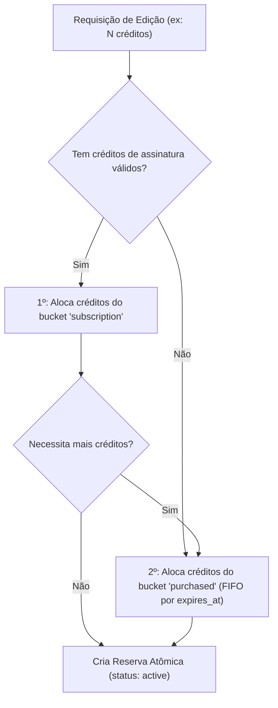
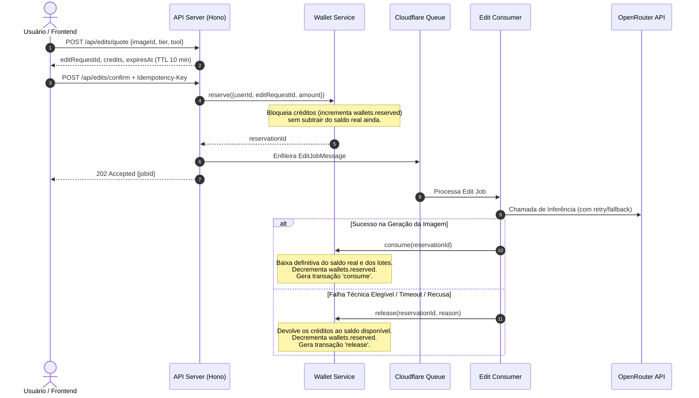

# ALEGON AI Photo Studio — Regras de Faturamento e Motor de Créditos

> **Documento Canônico de Regras de Negócio e Governança Financeira**  
> **Dono:** Especialista em Asaas e Billing (Subagente 5)  
> **Data:** 24/10/2026  
> **Versão:** 1.0.0  
> **Status:** Aprovado e Normativo  

---

## 1. Princípios Fundamentais do Motor de Créditos

O motor de créditos da ALEGON é projetado com base em integridade transacional de dupla entrada (*double-entry bookkeeping principles*), imutabilidade de eventos e proteção contra perdas financeiras e uso indevido.

1. **Paridade Padrão:** 1 crédito equivale a 1 edição com IA no tier **Padrão** (FLUX.1-dev / SDXL Inpainting / Gemini Pro Vision).
2. **Moeda Imutável e Inteira:** Créditos são sempre números inteiros positivos (`INTEGER`). Dinheiro é sempre armazenado em centavos de Real (`INTEGER`, ex.: R$ 19,90 = `1990`).
3. **Ledger Imutável:** Toda e qualquer movimentação de crédito gera uma linha na tabela `credit_transactions`. Linhas nessa tabela **nunca são atualizadas nem deletadas** (apenas inserções sequenciais auditadas).
4. **Saldo em Cache com Validação Cruzada:** A tabela `wallets` armazena o saldo consolidado atual (`purchased_balance`, `subscription_balance`, `reserved`) para alta performance nas consultas do usuário e validações pré-edição.
5. **Zero Saldo Negativo:** Nenhuma operação (nem mesmo débito administrativo ou estorno por reembolso) pode deixar o saldo do usuário negativo. Se o usuário já consumiu os créditos, o débito é limitado ao montante restante disponível.

---

## 2. Tipos de Buckets e Políticas de Validade

Os créditos do usuário são divididos em dois buckets distintos com ciclos de vida e prioridades de débito independentes:

### 2.1 Bucket de Assinatura (`subscription`)
- **Origem:** Concedidos automaticamente a cada pagamento mensal confirmado da assinatura recorrente (`grant_subscription`).
- **Planos Vigentes:**
  - *Pessoal:* 15 créditos / mês (R$ 29,90/mês).
  - *Pro:* 40 créditos / mês (R$ 69,90/mês).
  - *Business:* 100 créditos / mês (R$ 149,90/mês).
- **Validade e Expiração:**
  - Validade estritamente vinculada ao ciclo atual: `expires_at = current_period_end` (30 dias após a confirmação).
  - **Sem acúmulo (No rollover):** No término do ciclo mensal, os créditos de assinatura não consumidos expiram automaticamente. Isso garante a previsibilidade de custos de IA da ALEGON e viabiliza a margem de contribuição saudável modelada no estudo de *breakage*.
- **Comportamento em Cancelamento:** Se o usuário cancela a assinatura (`cancel_at_period_end = 1`), ele continua com acesso total aos créditos até o fim do período já pago.

### 2.2 Bucket Comprado Avulso / Pacotes (`purchased`)
- **Origem:** Compra pontual de Edição Avulsa ou Pacotes de Créditos via Pix ou Cartão de Crédito (`grant_purchase`, `grant_single_edit`).
- **Produtos Vigentes:**
  - *Edição Avulsa:* 1 crédito — **Validade de 30 dias corridos**.
  - *Pacote Inicial:* 5 créditos — **Validade de 365 dias corridos (12 meses)**.
  - *Pacote Criador:* 12 créditos — **Validade de 365 dias corridos (12 meses)**.
  - *Pacote Profissional:* 20 créditos — **Validade de 365 dias corridos (12 meses)**.
- **Lotes Independentes (`credit_lots`):** Cada compra cria um lote com `amount_initial`, `amount_remaining` e `expires_at`.
- **Expiração:** Após atingir a data de validade, o saldo remanescente do lote é expirado automaticamente pelo job de manutenção (`runBillingMaintenance`).

---

## 3. Ordem Canônica de Consumo (Algoritmo de Alocação)

Quando uma edição com IA é cotada e confirmada, o motor de créditos aloca os créditos necessários seguindo **estritamente a seguinte ordem**:

1. **1º — Créditos de Assinatura (`subscription`):** Como vencem no término do ciclo mensal, são consumidos prioritariamente para beneficiar o assinante e queimar os créditos de menor vida útil primeiro.
2. **2º — Créditos Comprados (`purchased`):** Consumidos em regime **FIFO (First In, First Out)** ordenados crescentemente pela data de vencimento (`expires_at ASC`). O lote que vence antes é debitado primeiro.

---

## 4. Fluxo de Duas Fases para Edições: Reserva e Liquidação

Para prevenir condições de corrida (*race conditions*), gastos duplicados (*double spending*) e perdas de créditos por falhas transitórias de infraestrutura, as edições de imagem adotam o padrão de **Reserva e Confirmação de Duas Fases (Two-Phase Commitment)**:

### 4.1 Fase 1: Reserva Atômica (`reserve`)
- **Método:** `walletService.reserve({ userId, editRequestId, amount, ttlMinutes = 30 })`
- **Validações:**
  - Checa se já existe reserva para `editRequestId`. Se existir e estiver `active` ou `consumed`, retorna o `reservationId` existente (idempotência perfeita).
  - Checa se o saldo disponível (`purchased_balance + subscription_balance - reserved >= amount`).
  - Se insuficiente, lança `InsufficientCreditsError(needed, available)`.
- **Efeito no Banco:**
  - Aloca os lotes de acordo com a ordem canônica (§3).
  - Salva em `credit_reservations`: `id`, `user_id`, `edit_request_id`, `amount`, `allocation_json`, `status = 'active'`, `expires_at = now + 30 min`.
  - Incrementa `wallets.reserved = reserved + amount`.
  - Registra em `credit_transactions` tipo `reserve`.

### 4.2 Fase 2A: Consumo Definitivo (`consume`)
- **Método:** `walletService.consume(reservationId)`
- **Ação:**
  - Se a reserva já estiver `consumed`, retorna imediatamente (idempotente).
  - Se estiver `released`, rejeita com erro.
  - Desfaz o `reserved` em `wallets`: `reserved = reserved - amount`.
  - Deduz os valores de cada lote conforme o `allocation_json`:
    - Atualiza `credit_lots.amount_remaining = amount_remaining - allocatedAmount`.
    - Deduz o montante respectivo de `wallets.subscription_balance` e/ou `wallets.purchased_balance`.
  - Atualiza status da reserva para `consumed` e grava `settled_at = now`.
  - Registra saída em `credit_transactions` com tipo `consume`.

### 4.3 Fase 2B: Liberação de Reserva (`release`)
- **Método:** `walletService.release(reservationId, reason)`
- **Ação:**
  - Se a reserva já estiver `released`, retorna imediatamente (idempotente).
  - Se já estiver `consumed`, rejeita pois créditos já foram consolidados.
  - Desfaz o valor reservado: `wallets.reserved = reserved - amount`.
  - Lotes de crédito nunca tiveram seu `amount_remaining` alterado, portanto voltam automaticamente a estar disponíveis para novas edições.
  - Atualiza status da reserva para `released`, grava `settled_at = now` e `release_reason = reason`.
  - Registra em `credit_transactions` com tipo `release`.

---

## 5. Manutenção Automática e Reconciliação (`runBillingMaintenance`)

Executado a cada 15 minutos via Cloudflare Cron Trigger (`*/15 * * * *`):

1. **Liberação de Reservas Abandonadas (Zumbis):**
   - Busca reservas com `status = 'active'` e `expires_at < nowIso()`.
   - Dispara `walletService.release(reservation.id, 'expired_ttl')`.
   - Garante que nenhum usuário fique com créditos travados indefinidamente se houver pane no consumidor da fila ou timeout do navegador.
2. **Expiração de Lotes de Crédito:**
   - Busca lotes em `credit_lots` com `amount_remaining > 0` e `expires_at < nowIso()`.
   - Para cada lote expirado:
     - Cria transação em `credit_transactions` com tipo `expire` e valor negativo igual a `amount_remaining`.
     - Subtrai de `wallets.purchased_balance` ou `wallets.subscription_balance`.
     - Zera `credit_lots.amount_remaining = 0`.
3. **Reconciliação e Auto-Cura de Saldos:**
   - Para cada carteira, recalcula a soma dos lotes ativos (`SUM(amount_remaining) WHERE expires_at > now`) e compara com `purchased_balance` e `subscription_balance`.
   - Se divergência for encontrada, ajusta o saldo em cache e registra alerta estruturado para suporte/auditoria.
4. **Sincronização de Cobranças Pendentes no Asaas:**
   - Identifica cobranças criadas há mais de 10 minutos com status `PENDING`.
   - Consulta a API do Asaas para verificar se houve pagamento com webhook perdido/atrasado.
   - Se o Asaas reportar `RECEIVED` ou `CONFIRMED`, dispara o fluxo de concessão de créditos automaticamente.

---

## 6. Política de Estornos e Reembolsos (`refund_reversal`)

1. **Gatilhos de Reembolso:**
   - Webhook do Asaas `PAYMENT_REFUNDED`.
   - Reembolso administrativo disparado pelo suporte em `POST /admin/payments/:id/refund`.
2. **Regras de Reversão de Créditos:**
   - O sistema localiza o pagamento em `asaas_payments`.
   - Se `credits_granted_at` for nulo, apenas marca o pagamento como `REFUNDED` e não debita créditos.
   - Se os créditos foram concedidos:
     - Localiza o lote gerado pelo pagamento (`source_type = 'payment'` e `source_id = payment.id`).
     - Se o lote ainda tiver créditos não utilizados (`amount_remaining > 0`), debita prioritariamente deste lote.
     - Se o lote já foi consumido total ou parcialmente, o sistema debita do saldo disponível total da carteira.
     - **Regra de Não-Negativação:** Se o usuário já tiver gasto todos os créditos (saldo disponível = 0), o débito é limitado a 0, sem negativar o saldo (`debited = Math.min(amount, available)`). A ocorrência é registrada em `audit_logs` para acompanhamento de risco/fraude.
     - Marca `credits_reversed_at = nowIso()`.

---

## 7. Proteção contra Fraude, Concorrência e Duplicidade

| Risco | Vetor de Ataque / Falha | Mecanismo de Defesa ALEGON |
|---|---|---|
| Clique duplo no checkout | Usuário clica várias vezes rápido no botão Pagar | Header `Idempotency-Key` obrigatório; `UNIQUE(user_id, idempotency_key)` na tabela `asaas_payments`. |
| Reenvio de webhook pelo Asaas | Instabilidade de rede provoca retries do mesmo webhook | Tabela `asaas_webhook_events` com coluna `asaas_event_id UNIQUE`. Eventos duplicados respondem HTTP 200 de imediato sem processamento duplo. |
| Concessão múltipla de créditos | Webhook recebido simultaneamente em workers paralelos | Coluna `credits_granted_at` checada e gravada em bloco atômico no D1. |
| Gasto duplo de créditos (*Double Spending*) | Usuário dispara 10 requisições simultâneas com 1 crédito em saldo | Reserva atômica no D1 com incremento de `wallets.reserved`. O saldo disponível é aferido considerando as reservas em voo. |
| Forjamento de webhook | Atacante envia POST falso para `/api/webhooks/asaas` | Validação estrita do cabeçalho `asaas-access-token` contra o segredo `env.ASAAS_WEBHOOK_TOKEN`. |
| Exposição de dados de cartão | Vazamento de banco ou interceptação de requisição | **Zero tráfego de dados de cartão**. O cliente paga diretamente no `invoiceUrl` hospedado e certificado do Asaas. |
