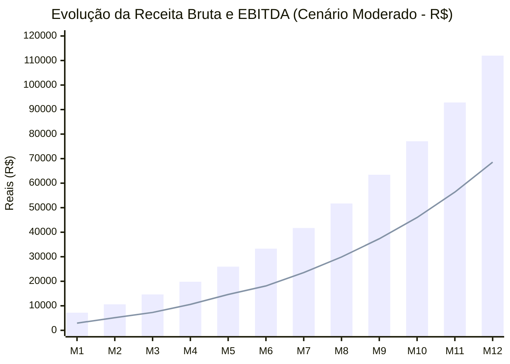

# ALEGON AI Photo Studio — Simulação de Receita e Projeção Financeira (12 Meses)

> **Documento Canônico de Modelagem Financeira**  
> **Dono:** Especialista Financeiro SaaS (Subagente 9)  
> **Data:** 24/10/2026  
> **Script Gerador:** [`docs/finance/simulate.mjs`](file:///C:/Users/Alex/.gemini/antigravity/scratch/alegon-ai-photo-studio/docs/finance/simulate.mjs)  
> **Arquivo de Dados Brutos:** [`docs/finance/simulation.csv`](file:///C:/Users/Alex/.gemini/antigravity/scratch/alegon-ai-photo-studio/docs/finance/simulation.csv)  

---

## 1. Visão Geral da Simulação

A projeção financeira da ALEGON foi desenhada para refletir o comportamento de crescimento de Micro-SaaS e plataformas de IA generativa orientadas a produto (*Product-Led Growth* - PLG), com duas fontes de monetização complementares:
1. **Transacional / Pay-as-you-go:** Venda avulsa e pacotes de créditos (validade de 30 a 365 dias).
2. **Recorrente (MRR):** Planos mensais com renovação automática e expiração de créditos não utilizados ao final de cada ciclo.

A simulação avalia a evolução de 12 meses sob três cenários estocasticamente delimitados: **Conservador**, **Moderado** e **Otimista**.

---

## 2. Premissas dos Cenários

| Parâmetro | Cenário Conservador | Cenário Moderado | Cenário Otimista | Justificativa / Fonte |
| :--- | :--- | :--- | :--- | :--- |
| **Cadastros Iniciais (Mês 1)** | 350 | 800 | 1.500 | Tráfego orgânico inicial, lista de espera e campanhas pontuais |
| **Crescimento Mensal de Tráfego** | 15% (decaimento a 5%) | 25% (decaimento a 10%) | 35% (decaimento a 15%) | Desaceleração natural de taxa percentual com o aumento da base |
| **Taxa de Conversão para Assinatura**| 4,0% | 6,0% | 8,0% | % de novos cadastrados que contratam planos mensais |
| **Distribuição de Planos (Pes/Pro/Bus)**| 70% / 24% / 6% | 60% / 30% / 10% | 50% / 35% / 15% | Adoção progressiva dos planos Pro e Business conforme valor é percebido |
| **Churn Mensal de Assinantes** | **8,0%** | **5,0%** | **3,5%** | Padrão SaaS B2C/SMB no Brasil (inadimplência + cancelamento voluntário) |
| **Taxa de Compra de Pacotes Avulsos** | 7,0% | 10,0% | 14,0% | Usuários que preferem compra sob demanda sem recorrência |
| **Distribuição de Pacotes** | 40% Avulso / 35% Ini / 18% Cria / 7% Prof | 30% Avulso / 35% Ini / 25% Cria / 10% Prof | 25% Avulso / 30% Ini / 30% Cria / 15% Prof | Migração para pacotes maiores induzida pela ancoragem de preço |
| **Taxa de Utilização de Créditos (Breakage)**| 80% (20% expiram) | 80% (20% expiram) | 80% (20% expiram) | Margem de segurança contratual (sem acúmulo de créditos de assinatura) |
| **CAC Médio por Cliente Pagante** | R$ 22,00 | R$ 16,00 | R$ 12,00 | Mix tráfego pago + SEO + indicação orgânica boca-a-boca |
| **Custos Fixos Mensais Iniciais** | R$ 800,00 | R$ 800,00 | R$ 800,00 | Ferramentas essenciais, Cloudflare Workers Paid, contabilidade enxuta |

---

## 3. Resumo dos Resultados Projetados (Consolidado 12 Meses)

### 3.1 Tabela Comparativa de Encerramento (Mês 12)

| Indicador (Mês 12) | Cenário Conservador | Cenário Moderado | Cenário Otimista |
| :--- | :--- | :--- | :--- |
| **Novos Usuários no Mês** | 1.187 | 6.551 | 24.634 |
| **Base de Assinantes Ativos** | **262 assinantes** | **1.786 assinantes** | **8.707 assinantes** |
| **Vendas Avulsas/Pacotes no Mês** | 83 compras | 655 compras | 3.449 compras |
| **Receita Recorrente Mensal (MRR)** | **R$ 12.273,80** | **R$ 96.241,40** | **R$ 538.539,30** |
| **Receita de Pacotes Avulsos** | R$ 1.795,70 | R$ 15.753,70 | R$ 110.270,40 |
| **Receita Bruta Total (Mês 12)** | **R$ 14.069,50** | **R$ 111.995,10** | **R$ 648.809,70** |
| **Deduções (Impostos + Asaas)** | R$ 1.284,99 | R$ 11.233,18 | R$ 73.190,69 |
| **Custos Variáveis IA + Infra** | R$ 1.522,35 | R$ 13.938,55 | R$ 72.509,19 |
| **Margem de Contribuição Líquida** | **R$ 11.262,16 (80,05%)** | **R$ 86.823,37 (77,52%)** | **R$ 503.109,82 (77,54%)** |
| **Custos Fixos de Operação** | R$ 1.300,00 | R$ 2.300,00 | R$ 2.300,00 |
| **Investimento em Marketing (CAC)** | R$ 2.860,00 | R$ 15.968,00 | R$ 71.952,00 |
| **EBITDA Projetado (Mês 12)** | **+ R$ 7.102,16** | **+ R$ 68.555,37** | **+ R$ 428.857,82** |

---

### 3.2 Faturamento Acumulado no 1º Ano (12 Meses)

| Métrica Acumulada (Ano 1) | Cenário Conservador | Cenário Moderado | Cenário Otimista |
| :--- | :--- | :--- | :--- |
| **Receita Bruta Acumulada** | **R$ 88.026,10** | **R$ 442.247,00** | **R$ 2.062.863,60** |
| **Receita Líquida (após impostos/taxas)**| R$ 78.435,26 | R$ 388.941,12 | R$ 1.794.691,33 |
| **Custos Totais de IA (OpenRouter)** | R$ 9.421,75 | R$ 51.522,75 | R$ 218.423,50 |
| **Custos Totais Cloudflare (R2/Workers)**| R$ 188,44 | R$ 1.030,46 | R$ 4.368,47 |
| **Margem de Contribuição Acumulada** | **R$ 70.472,31 (80,06%)** | **R$ 347.014,31 (78,47%)** | **R$ 1.605.345,17 (77,82%)** |
| **EBITDA Operacional Acumulado** | **+ R$ 36.568,31** | **+ R$ 219.866,31** | **+ R$ 1.258.985,17** |

---

## 4. Evolução Mês a Mês — Cenário Moderado (Caso Base)

O cenário moderado representa a curva de crescimento mais provável, ancorada em campanhas consistentes de marketing de performance, parcerias com microinfluenciadores de fotografia/e-commerce e boa conversão orgânica via SEO e marca:

### Detalhamento Mensal do Cenário Moderado:
- **Mês 1:** Receita R$ 7.184,50 \| 95 Assinantes \| 80 Compras Pacotes \| EBITDA R$ 2.930,53
- **Mês 3:** Receita R$ 14.652,20 \| 215 Assinantes \| 124 Compras Pacotes \| EBITDA R$ 7.288,95
- **Mês 6:** Receita R$ 33.320,20 \| 511 Assinantes \| 226 Compras Pacotes \| EBITDA R$ 18.104,47
- **Mês 9:** Receita R$ 63.442,60 \| 1.042 Assinantes \| 398 Compras Pacotes \| EBITDA R$ 37.340,29
- **Mês 12:** Receita R$ 111.995,10 \| 1.786 Assinantes \| 655 Compras Pacotes \| EBITDA R$ 68.555,37

---

## 5. Análise de Sensibilidade e Testes de Estresse

### 5.1 Sensibilidade à Variação Cambial (USD/BRL)
Se o dólar sofrer choque cambial e saltar de R$ 5,75 para R$ 7,50 (com câmbio efetivo de R$ 8,25):
- Custo de IA sobe de R$ 0,25 para R$ 0,33 por crédito padrão.
- Impacto na Margem de Contribuição do Plano Pro (R$ 69,90): cai de 77,1% para 72,4% (sob 100% de uso) ou 75,5% (sob 80% de uso).
- **Conclusão:** O negócio permanece altamente rentável e acima do piso de segurança de 70%, sem necessidade imediata de reajuste de preços.

### 5.2 Sensibilidade à Inadimplência no Asaas
Se a inadimplência no Pix/Cartão subir para 12%:
- O LTV médio cai proporcionalmente, mas a concessão atômica de créditos garante que **créditos nunca são liberados sem confirmação bancária** (`RECEIVED` ou `CONFIRMED` via webhook assinado).
- Portanto, a inadimplência afeta apenas o churn de MRR futuro, **com risco zero de consumo fantasma de API não paga**.

### 5.3 Break-Even do CAC (Payback)
- Com ticket médio ponderado de novos pagantes em ~R$ 38,00 e margem de contribuição de 78%:
  - Margem líquida gerada no 1º mês: ~R$ 29,60.
  - CAC médio praticado: R$ 16,00 a R$ 22,00.
  - **Payback Period: < 1 mês (recuperação imediata do investimento em marketing na primeira compra)**.
- Essa característica de *Payback D+0 / D+30* confere à ALEGON uma máquina de crescimento auto-financiável (*self-funding growth loop*).
