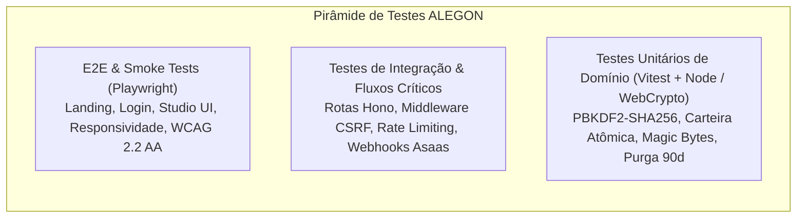

# ALEGON AI Photo Studio — Plano Mestre de Testes (QA & Homologação)

> **Documento Canônico de QA**  
> **Dono:** Subagente 8 (QA e Testes)  
> **Ambiente Alvo:** Cloudflare Workers (API Hono) + Static Assets (React SPA + Tailwind CSS) + Cloudflare D1 + Cloudflare R2 + Asaas Gateway (Sandbox/Prod) + OpenRouter AI  
> **Critério de Aceitação:** Zero defeitos críticos bloqueantes, cobertura automatizada dos fluxos críticos de integridade de saldo, isolamento de inquilinos e segurança LGPD.

---

## 1. Visão Geral e Estratégia de Qualidade

O ALEGON AI Photo Studio opera em arquitetura serverless de borda (Edge Cloudflare). Sua qualidade repousa em 6 pilares inegociáveis:
1. **Integridade Contábil Absoluta:** O saldo de créditos e o ledger financeiro são imutáveis e à prova de condições de corrida (*race conditions*). Saldo negativo é matematicamente impossível.
2. **Privacidade e Isolamento Multilocatário (LGPD):** Nenhum usuário pode acessar, listar ou descarregar imagens de terceiros. Chaves R2 são opacas e acessíveis exclusivamente via URLs efêmeras assinadas com HMAC. Imagens são purgadas impreterivelmente após 90 dias.
3. **Resiliência e Idempotência:** Webhooks do Asaas, cobranças e reservas atômicas toleram repetições de entrega de rede sem duplicar concessões de crédito ou cobranças.
4. **Segurança de Entrada (Defesa em Profundidade):** Uploads são inspecionados por *magic bytes* e varredura de assinaturas polyglot (HTML/SVG/scripts) antes de qualquer manipulação ou salvamento.
5. **Nenhuma Funcionalidade Falsa:** Qualquer ação exposta ao usuário deve funcionar de ponta a ponta ou exibir estado de desativação claro com explicação prévia.
6. **Acessibilidade e Usabilidade:** Conformidade rigorosa com WCAG 2.2 Nível AA, navegação fluida por teclado e suporte responsivo completo (mobile a desktop).

---

## 2. Matriz de Cobertura por Domínio

### 2.1 Autenticação e Gestão de Sessões

| ID | Cenário / Caso de Teste | Pré-condição | Entrada / Procedimento | Resultado Esperado | Severidade |
|---|---|---|---|---|---|
| **AUT-01** | Cadastro de Novo Usuário com Sucesso | E-mail inédito | POST `/api/auth/register` com dados válidos, aceite de Termos e Privacidade | Status 201, registro criado em `users` com status `active`, envio de e-mail de confirmação gravado em `email_outbox`, senha armazenada exclusivamente com hash PBKDF2-SHA256 (≥100.000 iterações). | Crítica |
| **AUT-02** | Rejeição de Senhas Fracas / Comuns | Usuário em registro ou alteração | Submissão de senhas < 10 caracteres ou contidas no dicionário de senhas fracas | Status 422 com código `PASSWORD_TOO_SHORT`, `PASSWORD_TOO_COMMON` ou `PASSWORD_TOO_SIMPLE`. | Alta |
| **AUT-03** | Login Válido com Emissão de Sessão Segura | Usuário ativo | POST `/api/auth/login` com credenciais corretas | Status 200, cookie `Set-Cookie` com prefixo seguro (`__Host-` em prod, `alegon_session` em dev), flags `HttpOnly; SameSite=Lax; Secure; Path=/`. Token opaco de 32 bytes randômico cujo SHA-256 é registrado em `sessions`. | Crítica |
| **AUT-04** | Bloqueio Progressivo de Conta (Lockout) | Usuário cadastrado | 5 falhas consecutivas de senha no POST `/api/auth/login` | A partir da 5ª tentativa, retorna HTTP 403 `ACCOUNT_LOCKED` com bloqueio progressivo (15 min, 30 min, 60 min exponencial). Contador zera após login correto. | Crítica |
| **AUT-05** | Expiração e Invalidação de Sessão | Sessão criada | Tentativa de requisição autenticada após 30 dias ou após logout | Retorna HTTP 401 `UNAUTHENTICATED`. Registro em `sessions` é marcado como revogado ou ignorado por `expires_at`. | Alta |
| **AUT-06** | Autenticação Multifator (MFA TOTP) para Administradores | Usuário com role `admin` | Login de admin com MFA ativo | Retorna `mfaRequired: true`. Sessão criada com `mfa_verified = 0`. Qualquer rota `/api/admin/*` é bloqueada com HTTP 403 `MFA_REQUIRED` até validação bem-sucedida via POST `/api/auth/mfa/verify`. | Crítica |
| **AUT-07** | Revogação Mútua de Outras Sessões | Usuário com múltiplas sessões ativas | POST `/api/auth/sessions/revoke-others` ou reset de senha | Todas as sessões anteriores do usuário recebem `revoked_at = now`, mantendo apenas a sessão corrente ativa. | Média |

---

### 2.2 Edição de Fotos e Motor de IA

| ID | Cenário / Caso de Teste | Pré-condição | Entrada / Procedimento | Resultado Esperado | Severidade |
|---|---|---|---|---|---|
| **EDI-01** | Upload de Arquivo com Magic Bytes Válidos | Usuário logado | Upload multipart (`file`) de JPEG, PNG e WebP válidos (≥64x64px, ≤40MP, ≤15MB) | Status 201, registro em `images` e versão `kind = 'original'`, arquivo salvo no R2 em `u/{userId}/i/{imageId}/v/{versionId}.{ext}` com miniatura opcional. | Crítica |
| **EDI-02** | Rejeição Estrita de Arquivos Corrompidos ou Inválidos | Usuário logado | Envio de PDF, executável, arquivo de texto renomeado como `.jpg` ou buffer truncado | Rejeição imediata com HTTP 415 `UPLOAD_INVALID_FORMAT` ou 422 `UPLOAD_CORRUPTED`. Nenhum binário gravado no R2. | Crítica |
| **EDI-03** | Cotação Transparente de Créditos (Quote) | Imagem existente | POST `/api/edits/quote` com `tool` (1 das 14 ferramentas) e `tier` | Retorna `editRequestId`, custo em créditos configurado, rótulo amigável do modelo, validade da cotação e saldo atual do usuário. | Alta |
| **EDI-04** | Reserva Atômica de Créditos | Cotação válida | POST `/api/edits/confirm` com `editRequestId` e `Idempotency-Key` | Retorna HTTP 202 com `jobId`. O valor exato dos créditos é transferido de `available` para `reserved` em transação D1 atômica. | Crítica |
| **EDI-05** | Consumo Definitivo em Sucesso da IA | Job em execução | Processamento concluído pelo worker com sucesso | Versão editada salva no R2, nova linha em `image_versions` (`kind = 'edit'`), reserva liquidada (`status = 'consumed'`), lotes de crédito debitados. **A imagem original NUNCA é sobrescrita.** | Crítica |
| **EDI-06** | Liberação de Créditos em Falha Técnica Elegível | Job em execução | Falha transitória do modelo de IA (timeout ou indisponibilidade técnica da API) | Reserva liberada (`status = 'released'`), créditos retornam integralmente a `available`. Nenhuma perda de saldo para o cliente. | Crítica |
| **EDI-07** | Polling Gradual de Status do Job | Job enfileirado | Requisições periódicas a `GET /api/edits/jobs/:id` | Retorna status progressivo (`queued` → `processing` → `succeeded` / `failed`). Resposta inclui `resultVersionId` quando concluído. | Alta |

---

### 2.3 Motor Financeiro e Gateway Asaas

| ID | Cenário / Caso de Teste | Pré-condição | Entrada / Procedimento | Resultado Esperado | Severidade |
|---|---|---|---|---|---|
| **FIN-01** | Checkout Pix com Geração de QR Code | Catálogo ativo | POST `/api/billing/checkout` com `productCode` e `billingType: "PIX"` + `Idempotency-Key` | Retorna `paymentId`, payload copia-e-cola do Pix e QR Code em base64. Registro em `asaas_payments` com status inicial `PENDING`. | Crítica |
| **FIN-02** | Webhook de Pagamento com Idempotência Estrita | Pagamento pendente | POST `/api/webhooks/asaas` com evento `PAYMENT_RECEIVED` ou `PAYMENT_CONFIRMED` e `asaas-access-token` válido | Retorno HTTP 200 imediato. Evento gravado com chave única `asaas_event_id`. Fila processa concessão atômica de lote em `credit_lots`. Reenvio idêntico do webhook detecta evento prévio e não duplica créditos. | Crítica |
| **FIN-03** | Proteção contra Concessão Antecipada em Redirecionamento | Checkout iniciado | Usuário fecha modal ou redireciona sem confirmação bancária | Créditos permanecem inalterados. Créditos só ingressam na carteira mediante confirmação assinada via webhook ou consulta oficial da API Asaas. | Crítica |
| **FIN-04** | Estorno / Reembolso Financeiro | Pagamento confirmado com créditos concedidos | Evento de webhook `PAYMENT_REFUNDED` ou solicitação admin | Execução de `wallet.debit` com tipo `refund_reversal`. Créditos restantes daquele lote são estornados. Se o usuário já consumiu parte dos créditos, debita no máximo o saldo remanescente disponível, sem nunca gerar saldo negativo. | Crítica |
| **FIN-05** | Recusa de Pagamento / Falha de Cobrança | Assinatura ou Pix vencido | Evento `PAYMENT_OVERDUE` ou recusa de cartão | Assinatura/pagamento transiciona para `overdue`. Nenhuma alteração espúria nos créditos. | Alta |

---

### 2.4 Biblioteca de Fotos e Retenção Privativa de 90 Dias

| ID | Cenário / Caso de Teste | Pré-condição | Entrada / Procedimento | Resultado Esperado | Severidade |
|---|---|---|---|---|---|
| **RET-01** | Cálculo e Exibição de Dias Restantes | Imagens ativas na biblioteca | Consulta a `GET /api/images` | Cada imagem retorna campo `daysLeft` calculado a partir de `expires_at = created_at + 90 dias`. Alerta visual caso `daysLeft <= 7`. | Alta |
| **RET-02** | Notificação Prévia de Retenção (Aviso 7 Dias) | Fotos a vencer em ≤ 7 dias | Execução da rotina Cron `runRetention(env)` | Criação de notificação in-app (`type = 'retention_warning'`), e-mail de aviso disparado, campo `expiry_notified_at` preenchido evitando avisos repetidos. | Alta |
| **RET-03** | Purga Automática e Exclusão Física no R2 | Fotos com `expires_at <= now` | Execução diária da rotina Cron | Todas as chaves associadas no R2 (`r2_key` e `thumb_r2_key`) são excluídas via `storage.deleteKeys()`. Registros em `image_versions` e `images` recebem `deleted_at = now` e `deletion_reason = 'retention'`. | Crítica |
| **RET-04** | Exclusão Antecipada Solicitada pelo Usuário | Foto existente | DELETE `/api/images/:id` autenticado pelo dono da foto | Exclusão física imediata no R2 de todas as versões da imagem. Metadados marcados como `deleted_at = now` e `deletion_reason = 'user'`. | Crítica |
| **RET-05** | Direito ao Esquecimento / Exclusão Total de Conta (LGPD) | Solicitação em `deletion_requests` com `confirm = "EXCLUIR"` | Execução do expurgo de conta na rotina de retenção | Prefixo `u/{userId}/` no R2 é completamente expurgado. E-mail e nome são anonimizados. Sessões, tokens e segredos MFA são deletados. Transações fiscais mantidas anonimizadas para cumprimento legal. | Crítica |

---

### 2.5 Segurança, Proteção de Dados e Controles de Acesso

| ID | Cenário / Caso de Teste | Pré-condição | Entrada / Procedimento | Resultado Esperado | Severidade |
|---|---|---|---|---|---|
| **SEC-01** | Tentativa de Bypass de Créditos em Edição | Saldo de créditos inferior ao custo do tier | POST `/api/edits/confirm` com saldo insuficiente | Lança `InsufficientCreditsError` e responde HTTP 402 `INSUFFICIENT_CREDITS`. Nenhuma mensagem enviada à fila de execução. | Crítica |
| **SEC-02** | Bloqueio de Imagens Polyglot / SVG / HTML Malicioso | Requisição de upload | Arquivo com cabeçalho JPEG/PNG contendo tags embutidas como `<?xml`, `<svg`, `<script>`, `<iframe>` | Rejeição por `validateImageUpload` com HTTP 415 `UPLOAD_INVALID_CONTENT`. | Crítica |
| **SEC-03** | Isolamento de Acesso a Imagens via Assinatura HMAC | Usuário A tentando acessar imagem de Usuário B | Tentativa de acessar `/api/files/:token` forjando o token ou usando token assinado para outro `userId` | Resposta HTTP 403 `FORBIDDEN` ou 401. URL assinada tem TTL máximo de 5 minutos e validação criptográfica estrita vinculada à identidade da sessão. | Crítica |
| **SEC-04** | Proteção CSRF em Métodos Mutantes | Requisição de alteração de estado | POST / PUT / PATCH / DELETE sem cabeçalho `X-Requested-With: alegon` ou com `Origin` não autorizada | Resposta HTTP 403 com erro `CSRF_INVALID`. Rota de webhook externo isenta de acordo com a arquitetura. | Crítica |
| **SEC-05** | Cabeçalhos de Segurança (Security Headers) | Qualquer resposta da API | Inspecionar cabeçalhos HTTP retornados | Presença obrigatória de `X-Content-Type-Options: nosniff`, `X-Frame-Options: DENY`, `Strict-Transport-Security`, `Referrer-Policy: strict-origin-when-cross-origin` e CSP compatível. | Alta |
| **SEC-06** | Limite de Taxa (Rate Limiting) | IP ou usuário disparando requisições abusivas | Disparos repetidos acima do limite na janela estipulada | Retorna HTTP 429 `RATE_LIMITED` com cabeçalhos `RateLimit-Limit`, `RateLimit-Remaining` e `Retry-After`. | Alta |

---

### 2.6 Responsividade e Acessibilidade (WCAG 2.2 Nível AA)

| ID | Cenário / Critério WCAG | Dimensão de Teste | Procedimento / Verificação | Resultado Esperado | Severidade |
|---|---|---|---|---|---|
| **A11Y-01** | Contraste de Cores (Critério 1.4.3) | Modo Claro e Escuro | Medição de taxa de contraste de textos e controles interativos | Relação de contraste mínima de 4.5:1 para texto normal e 3:1 para textos grandes ou elementos de interface. Paleta Ouro ALEGON com contraste verificado. | Alta |
| **A11Y-02** | Navegação por Teclado e Foco Visível (Critério 2.4.7) | Todos os componentes | Navegação sequencial via tecla `Tab`, ativação via `Enter` e `Space` | Anel de foco visível (`ring-2 ring-primary ring-offset-2`). Nenhum bloqueio de foco (*keyboard trap*). | Alta |
| **A11Y-03** | Controle Antes/Depois Acessível | Slider de Comparação | Uso de teclas direcionais (setas esquerda e direita) no componente `BeforeAfterSlider` | Ajuste gradativo de 5% da divisão entre as imagens, informando valor atual via atributo `aria-valuenow`. | Alta |
| **A11Y-04** | Anúncios Dinâmicos de Status (Critério 4.1.3) | Toasts, Alertas e Progresso | Mudança de estado assíncrono (ex: barra de progresso, toast) | Elementos sinalizados com `role="status"` ou `role="alert"` para leitura imediata por leitores de tela. | Alta |
| **RESP-01** | Layout Adaptável a Dispositivos Móveis | Viewports de 375px (iPhone), 768px (Tablet), 1440px (Desktop) | Renderização do AppShell, navegação e catálogo de ferramentas | Menu colapsável em gaveta (*Drawer*), sem estouro horizontal de tela (*horizontal overflow*), alvos de toque com dimensão mínima de 44x44px. | Alta |

---

## 3. Ambiente e Execução dos Testes Automatizados

### 3.1 Suite Unitária e de Integração Backend
- **Framework:** Vitest (workspace `unit-node` para testes rápidos com `node:sqlite` e WebCrypto).
- **Comando de Execução:** `cd apps/api; npx.cmd vitest run --project unit-node`
- **Diretórios de Teste:**
  - `apps/api/test/auth.test.ts`
  - `apps/api/test/wallet.test.ts`
  - `apps/api/test/security.test.ts`
  - `apps/api/test/retention.test.ts`

### 3.2 Suite End-to-End Frontend
- **Framework:** Playwright Test com emulação de viewport e verificações visuais/acessíveis.
- **Arquivo de Smoke:** `apps/web/e2e/smoke.spec.ts`
- **Comando de Execução:** `npm.cmd run e2e -w apps/web`

---

## 4. Critérios de Homologação para Liberação (Go/No-Go)

Para aprovação de release de produção:
1. **100% dos testes unitários e de integração aprovados** sem falhas ou exceções não tratadas.
2. **Nenhuma violação crítica de segurança ou LGPD** (URLs públicas, vazamento de imagens, bypass de saldo).
3. **Audit de conformidade de código executado com sucesso.**
4. **Evidências de execução registradas com timestamps e saídas dos comandos reais.**
