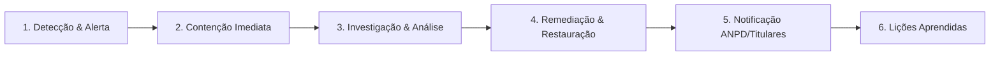

# PLANO DE RESPOSTA A INCIDENTES DE SEGURANÇA E LGPD
**ALEGON AI Photo Studio — ALEGON Marketing & Tecnologia**
*Conforme Resolução CD/ANPD nº 15/2024 e Art. 48 da Lei nº 13.709/2018*

Este documento estabelece as diretrizes operacionais e o protocolo formal de atuação em caso de detecção, contenção, investigação e comunicação de incidentes de segurança da informação envolvendo dados pessoais na plataforma ALEGON AI Photo Studio.

---

### 1. Classificação do Incidente

| Nível de Gravidade | Critério de Enquadramento | Exemplo Prático | Prazo de Ação |
|---|---|---|---|
| **Baixo** | Sem afetação de dados pessoais sensíveis ou confidencialidade de titulares. | Bloqueio temporário de requisições por rate-limit ou instabilidade passageira. | Até 24 horas |
| **Médio** | Indisponibilidade de serviço ou tentativa frustrada de escalonamento de privilégios. | Falha em fila assíncrona ou ataque de força bruta bloqueado pelo sistema. | Até 4 horas |
| **Alto / Crítico** | Risco relevante de dano aos direitos dos titulares (vazamento, acesso não autorizado ou perda de integridade). | Suposta exposição de imagens privadas ou comprometimento de chaves de API. | **Imediato (Até 1 hora)** |

---

### 2. Fluxo Operacional de Resposta

#### Fase 1: Detecção e Alerta
- Identificação por monitoramento de logs anômalos no Cloudflare Workers, alertas de volume no OpenRouter ou denúncia através do canal `privacidade@alegon.com.br`.
- Notificação imediata ao Tech Lead e ao Encarregado de Proteção de Dados (DPO).

#### Fase 2: Contenção Imediata
- Se envolver credencial comprometida: **Rotação imediata da chave** no Cloudflare Secrets / painel do provedor correspondente.
- Se envolver sessão comprometida: Execução do script de revogação forçada de sessões no banco D1 (`UPDATE sessions SET revoked_at = datetime('now') WHERE user_id = ?`).
- Se envolver IP abusivo: Bloqueio imediato na camada de borda do Cloudflare WAF.

#### Fase 3: Investigação e Análise Forense
- Análise da tabela `audit_logs` no D1 e dos registros estruturados do Cloudflare Logpush.
- Determinação da extensão do incidente: número de titulares afetados, dados envolvidos e período de exposição.

#### Fase 4: Remediação e Restauração
- Aplicação de correção emergencial no código-fonte.
- Restauração de dados íntegros a partir do histórico do D1 Time Travel, caso aplicável.

#### Fase 5: Notificação à ANPD e aos Titulares (Resolução CD/ANPD nº 15/2024)
- **Prazo Legal de Comunicação à ANPD:** A comunicação deve ocorrer no prazo de **3 (três) dias úteis**, contados a partir do conhecimento da certeza do incidente que possa acarretar risco ou dano relevante aos titulares.
- **Conteúdo da Notificação:**
  * Natureza dos dados pessoais afetados.
  * Informações sobre os titulares envolvidos.
  * Indicação das medidas técnicas e de segurança adotadas.
  * Riscos potenciais decorrentes do incidente.
  * Medidas adotadas ou que serão adotadas para reverter ou mitigar os efeitos.
  * Contato do Encarregado (DPO).
- **Comunicação aos Titulares:** Disparada via e-mail direto em linguagem clara e acessível, orientando ações de precaução caso necessárias.

#### Fase 6: Lições Aprendidas e Aprimoramento
- Reunião pós-incidente e elaboração de relatório conclusivo (*post-mortem*), atualizando o modelo de ameaças STRIDE e inserindo novos testes automatizados de regressão.
