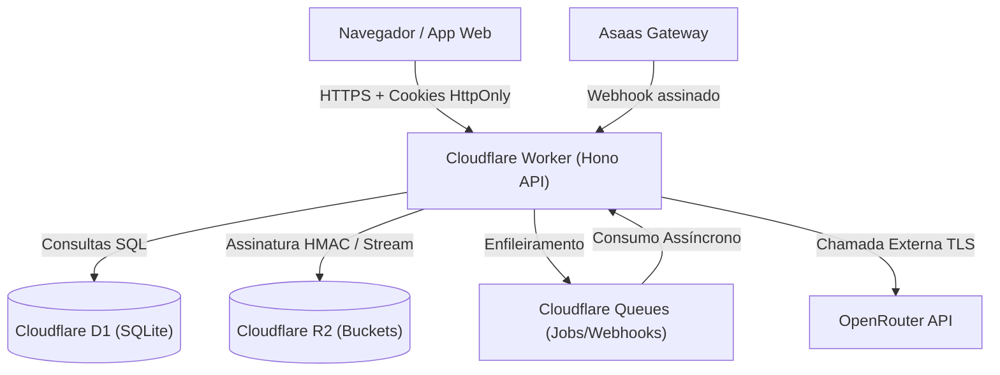

# MODELAGEM DE AMEAÇAS (STRIDE) E ARQUITETURA DEFENSIVA
**ALEGON AI Photo Studio — ALEGON Marketing & Tecnologia**

Este documento mapeia os vetores de ataque potenciais contra o ecossistema da ALEGON AI Photo Studio, aplicando a metodologia **STRIDE** (Spoofing, Tampering, Repudiation, Information Disclosure, Denial of Service, Elevation of Privilege) para cada componente crítico da arquitetura.

---

### 1. Diagrama de Superfície de Ataque

---

### 2. Matriz de Ameaças STRIDE e Mitigações

#### 2.1 Autenticação e Sessões (Spoofing & Tampering)
* **Ameaça:** Forjamento de cookies de sessão ou roubo de tokens via XSS.
  * *Mitigação:* Cookies com atributos `HttpOnly; Secure; SameSite=Lax`. Tokens de sessão opacos de 32 bytes gerados por CSPRNG WebCrypto. No banco D1 é armazenado apenas o hash `SHA-256(token)`, impedindo reutilização mesmo em caso de vazamento de banco.
* **Ameaça:** Ataques de força bruta contra senhas de usuários.
  * *Mitigação:* Hash lento de senha com PBKDF2-SHA256 (100.000 iterações e salt criptográfico único de 16 bytes). Bloqueio progressivo de 15 minutos após 5 falhas consecutivas e rate limiting por IP.
* **Ameaça:** Comprometimento de credenciais de administradores.
  * *Mitigação:* Exigência compulsória de autenticação de dois fatores (TOTP RFC 6238) para usuários com papel `admin`. Sessões administrativas sem MFA verificado têm acesso restrito apenas à rota de verificação.

#### 2.2 Upload de Arquivos e Armazenamento R2 (Tampering & Information Disclosure)
* **Ameaça:** Upload de arquivos maliciosos (shells PHP, scripts embutidos em SVG ou polyglots JPEG/HTML).
  * *Mitigação:* Validação profunda de *magic bytes* reais via `src/security/upload.ts`. O cabeçalho e rodapé do binário são inspecionados para rejeitar quaisquer marcadores `<script`, `<svg` ou `<?php`. Dimensões máximas limitadas a 40 Megapixels e tamanho máximo de 15 MB.
* **Ameaça:** Enumeração ou acesso cruzado a fotos de outros usuários (IDOR).
  * *Mitigação:* O bucket Cloudflare R2 não possui domínio público. Todas as imagens são acessadas através do endpoint `GET /api/files/:token`, cujo token é assinado com HMAC-SHA256 utilizando `SESSION_SECRET` e vinculando o `userId` solicitante. Se o ID do usuário na sessão não coincidir com o do token, a requisição é rejeitada com 403 Forbidden.

#### 2.3 Sistema de Créditos e Faturamento (Tampering & Elevation of Privilege)
* **Ameaça:** Condição de corrida (*race condition*) para gastar o mesmo saldo em requisições simultâneas.
  * *Mitigação:* Operações na carteira utilizam atualização condicional atômica (`UPDATE wallets SET reserved = reserved + ? WHERE user_id = ? AND (purchased_balance + subscription_balance - reserved) >= ?`) com verificação rigorosa das linhas afetadas, garantindo que o saldo nunca fique negativo.
* **Ameaça:** Falsificação de confirmação de pagamento para obtenção ilícita de créditos.
  * *Mitigação:* O endpoint `POST /api/webhooks/asaas` exige validação do cabeçalho `asaas-access-token` em comparação de tempo constante (`crypto.subtle.timingSafeEqual`). A concessão de créditos é idempotente e só ocorre após a transição real para `RECEIVED` ou `CONFIRMED`.

#### 2.4 Integração com OpenRouter e Inteligência Artificial (Denial of Service & Repudiation)
* **Ameaça:** Injeção de instruções (*prompt injection*) para burlar políticas de segurança ou alterar regras de sistema.
  * *Mitigação:* O prompt do usuário é tratado estritamente como dado de entrada em bloco delimitado, nunca como instrução de sistema (`src/ai/prompts.ts`). Há limites de caracteres e sanitização de caracteres de controle.
* **Ameaça:** Esgotamento financeiro através de chamadas abusivas à API OpenRouter.
  * *Mitigação:* Verificação e reserva prévia de créditos em carteira antes de qualquer chamada externa. Limites diários globais configuráveis em `system_settings` e rate limiting por usuário.

---

### 3. Cabeçalhos de Segurança HTTP (Content Security Policy)
Implementados em `src/security/headers.ts`:
- `Content-Security-Policy: default-src 'self'; script-src 'self'; style-src 'self' 'unsafe-inline'; img-src 'self' blob: data:; connect-src 'self'; frame-ancestors 'none';`
- `Strict-Transport-Security: max-age=31536000; includeSubDomains; preload`
- `X-Content-Type-Options: nosniff`
- `X-Frame-Options: DENY`
- `Referrer-Policy: strict-origin-when-cross-origin`
- `Permissions-Policy: camera=(self), microphone=(), geolocation=()`
